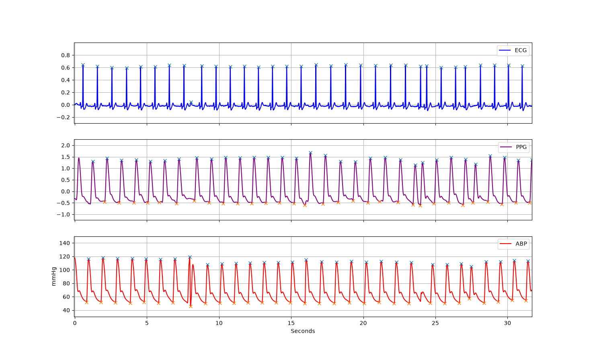
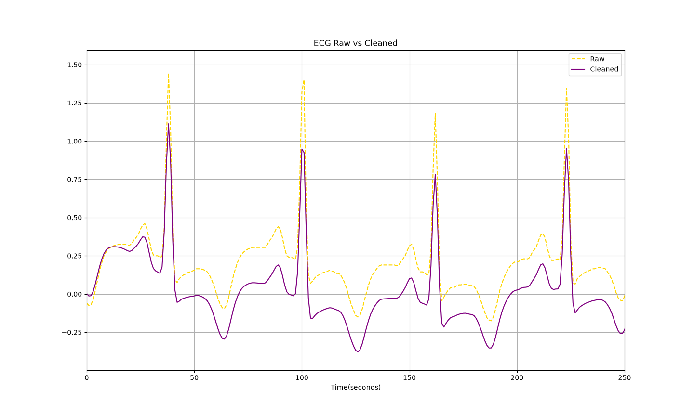

# BP Prediction from ECG and PPG features
- This project attempts to accurately predict systolic and diastolic blood pressure using ECG and PPG signals.
- The goal is to achieve continuous blood pressure monitoring without the need for invasive arterial lines or noninvasive cuffs.

## Train a model

The processed data and the train/test split are already in the repo, so you don't need to download anything.

1. Clone the repo and set up the environment (Python 3.12):
    ```bash
    git clone https://github.com/chaykup/bp-from-ecg-ppg.git
    cd bp-from-ecg-ppg
    python3 -m venv .venv
    source .venv/bin/activate        # Windows: .venv\Scripts\activate
    pip install -r requirements.txt
    ```
2. Open `src/model.py`. It already loads the data into these variables:

    | Variable | Contents |
    | --- | --- |
    | `X_train`, `X_test` | Features, ready to use (cleaned, missing values filled, scaled). 240,948 train and 60,833 test rows, 11 columns |
    | `y_train`, `y_test` | Targets: columns `sbp` and `dbp` (mmHg) |
    | `groups_train` | The record each training row came from |

3. Write your model below the loading line, then run it from the repo root:
    ```bash
    python src/model.py
    ```

Tips:
- **Two targets.** Most scikit-learn regressors accept both columns of `y_train` at once. `SVR` and `HistGradientBoostingRegressor` don't; wrap them in `MultiOutputRegressor`.
- **Cross-validation.** Use `GroupKFold(5)` and pass `groups=groups_train` to `fit`, so windows from one record never sit in both a training and a validation fold.
- **Test set.** Only score on `X_test`/`y_test` once your model is final.

## Rebuild the data from scratch (optional)

1. Download the four `Part_*.mat` files from the [UCI repository](https://archive.ics.uci.edu/dataset/340/cuff+less+blood+pressure+estimation) into `data/raw/`.
2. Run, from the repo root:
    ```bash
    python src/build_table.py    # writes data/processed/features.parquet (~5 min)
    python src/split.py          # writes data/processed/split.csv
    python src/eda.py            # writes figures/eda/
    ```



